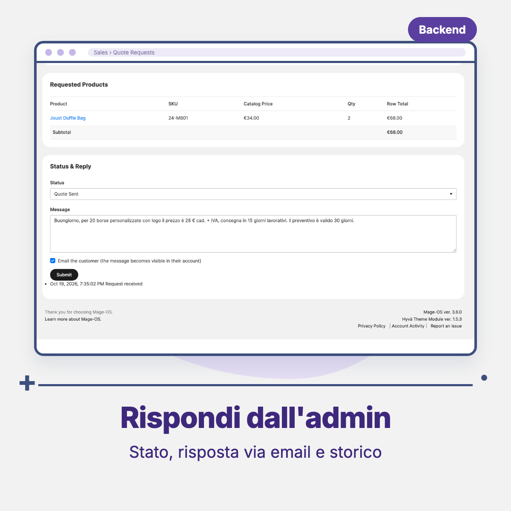

# Threecommerce_CatalogMode: catalog mode and quote requests for Magento 2 / Mage-OS

**Catalog mode** for Magento 2 and Mage-OS: turn off online purchasing **per store view** while the catalog stays online, choose how prices are shown, and optionally turn the checkout into a **quote request**.

**Compatibility:** Magento Open Source / Adobe Commerce 2.4.4+ · Mage-OS 3.x · PHP 8.1 – 8.4 · Frontend templates target Hyvä
**License:** commercial · coming soon

## Features

- **Disable purchasing** per store view (for example sell on `it`, catalog only on `en`), optionally only for some customer groups.
- **Price display**: show prices, show only the recommended retail price (the `msrp` attribute, with a fallback text), or hide prices and show a configurable text (default "Price on request"). Hidden prices are also removed from cart lines and totals, mini cart, configurable/swatch JSON config, the price sort option and the layered navigation price filter.
- **Quote mode off**: add to cart buttons, quantity, mini cart and express checkout buttons disappear; cart, checkout, multishipping and PayPal Express redirect to the home page.
- **Quote mode on**: products can still be added to the cart, the cart shows a "Request a Quote" button and every checkout entry point leads to a quote request form (contact, optional address, message). The request is stored, the cart is emptied and customer and store are notified by email.
- **Admin** (Sales → Quote Requests): grid with full-text search and mass delete, detail page with products and catalog prices at request time, status (New, In Progress, Quote Sent, Accepted, Converted to Order, Rejected, Expired, Closed) and replies emailed to the customer, with history.
- **Quote expiry**: every sent quote gets a *Valid Until* date (default validity in days, editable per request); after that date the quote moves to *Expired* automatically, optionally emailing the customer.
- **Response time and quote-to-order rate**: the first reply of the store is timestamped, the order created from a quote can be linked by its number, and a KPI table above the grid shows requests awaiting a reply, average first reply time, quotes sent, quotes turned into orders, conversion rate and expired quotes (last 30 / 90 days and all time).
- **Customer account** (My Quote Requests): list and detail with the replies received and the quote validity date.
- **Server-side guards** on frontend, GraphQL, REST and SOAP: adding to the cart and placing an order are refused when catalog mode applies. Orders created from the admin are never affected.
- Layout handles for custom layout XML: `catalogmode_active`, `catalogmode_purchase_blocked`, `catalogmode_quote`, `catalogmode_price_hidden`.

## Requirements

- Magento Open Source / Adobe Commerce 2.4.4+ or Mage-OS
- PHP 8.1 – 8.4
- Hyvä theme for the bundled frontend templates

## Availability

This module is **not yet available for purchase**. See the [product page](https://www.threecommerce.it/modalita-catalogo-preventivi-magento-2?utm_source=github&utm_medium=readme&utm_campaign=magento2-catalog-mode) for the current status, or [get in touch](https://www.threecommerce.it/contatti?utm_source=github&utm_medium=readme&utm_campaign=magento2-catalog-mode) to be notified when it is released or to ask for details.

## Configuration

Admin → **Stores → Configuration → Catalog → Catalog Mode & Quote Requests**. All settings are store view scoped; saving the section cleans the full page, block and layout caches.

## Known limitations

- Bundle option labels and custom option labels may still contain price deltas.

## Documentation and support

- Product page: [threecommerce.it/modalita-catalogo-preventivi-magento-2](https://www.threecommerce.it/modalita-catalogo-preventivi-magento-2?utm_source=github&utm_medium=readme&utm_campaign=magento2-catalog-mode)
- [Changelog](CHANGELOG.md)
- Questions and custom development: [threecommerce.it/contatti](https://www.threecommerce.it/contatti?utm_source=github&utm_medium=readme&utm_campaign=magento2-catalog-mode)

---

*This repository is the public showcase of the module. The source code is kept in a private repository.*
